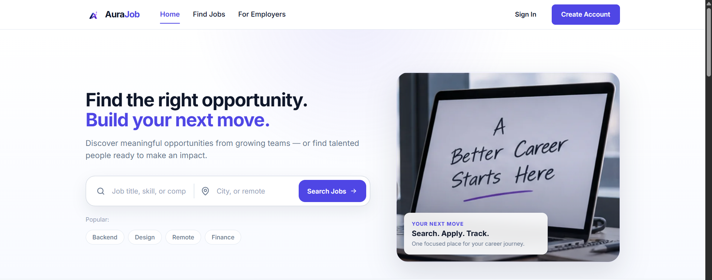
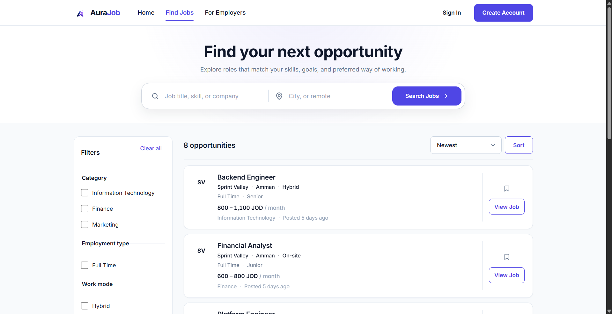
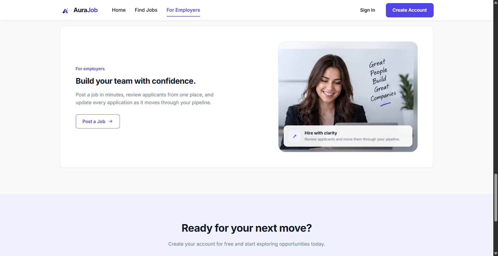
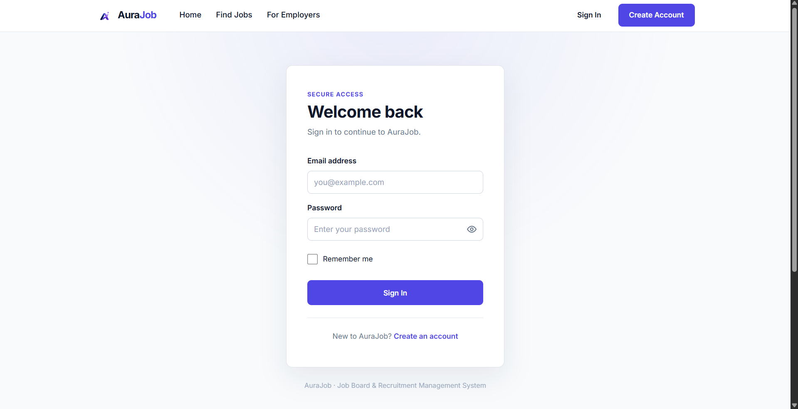
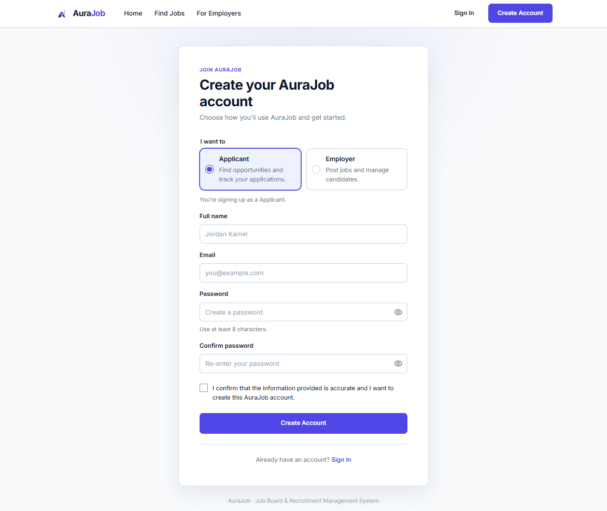
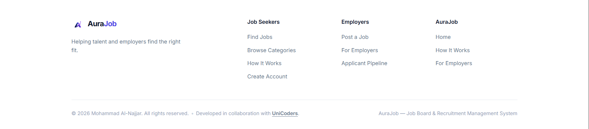

# AuraJob

<p align="center"></p>

**AuraJob** is a full-stack **Job Board & Recruitment Management System** built with PHP, MySQL, HTML, CSS, and vanilla JavaScript. It supports two roles—Applicants and Employers—and covers the complete recruitment flow from job discovery and applications to employer review, status tracking, saved jobs, and in-app notifications.

## Screenshots

### Home



### Find Jobs



### For Employers



### Authentication

<table>
  <tr>
    <td width="50%"><strong>Sign In</strong><br></td>
    <td width="50%"><strong>Create Account</strong><br></td>
  </tr>
</table>

### Footer



## Key Features

### Public
- Responsive landing page and job discovery experience
- Server-side job search, filtering, sorting, and pagination
- AJAX-enhanced job search/filtering with a normal GET fallback when JavaScript is unavailable
- Job details with company, salary, location, work mode, experience level, and deadline information
- Share jobs with the native Web Share API when available, with clipboard-copy fallback

### Applicant
- Registration, login, logout, and optional **Remember me** session cookie
- Applicant dashboard with application statistics and recent activity
- Profile management, including AES-256-GCM encrypted phone storage
- Apply to active jobs with duplicate-application protection
- View, filter, and track applications
- Cancel eligible in-progress applications
- Save/unsave jobs with AJAX persistence
- In-app notifications for application status changes

### Employer
- Employer dashboard with job/application statistics
- Company profile management
- Full job CRUD: create, read, update, close, and delete owned jobs
- View applicants per job
- Review individual applications
- Controlled application-status workflow
- In-app notifications when new applications are submitted

## Technology Stack

- **Frontend:** HTML5, CSS3, vanilla JavaScript
- **Backend:** PHP 8+
- **Database:** MySQL 8 / InnoDB / utf8mb4
- **Database API:** MySQLi prepared statements
- **AJAX:** Fetch API
- **Security:** Sessions, CSRF protection, server-side role/ownership checks, password hashing, output escaping, AES-256-GCM encryption

## Project Structure

```text
AuraJob/
├── app/
│   ├── Core/          # config, database, authentication/session helpers
│   ├── Services/      # encryption and notification service
│   ├── Support/       # reusable helpers and shared form logic
│   └── Views/         # shared header/footer/access-denied view
├── public/            # web document root
│   ├── applicant/     # applicant-only routes
│   ├── employer/      # employer-only routes
│   └── assets/        # CSS and JavaScript
├── database/
│   ├── schema.sql
│   ├── seed.sql        # baseline categories only; no accounts
│   ├── demo-seed.sql   # optional fictional demo data
│   ├── database.sql    # clean combined schema + baseline categories
│   ├── ERD.md
│   ├── DATABASE_NOTES.md
│   └── migrations/
├── docs/              # UI/UX, component, and flow documentation
├── storage/uploads/   # runtime uploads; contents ignored by Git
├── .env.example
├── .gitignore
├── PROJECT_PLAN.md
└── README.md
```

The application is intentionally served from `public/` so internal PHP code, `.env`, database files, documentation, and runtime storage are outside the web root.

## Database

AuraJob uses eight related tables:

- `users`
- `applicant_profiles`
- `companies`
- `categories`
- `jobs`
- `applications`
- `saved_jobs`
- `notifications`

Important integrity rules include:

- unique user email
- one applicant profile per applicant
- one company per employer
- one application per applicant/job pair
- one saved-job record per applicant/job pair
- foreign keys with deliberate `CASCADE` / `RESTRICT` behavior

See `database/ERD.md` and `database/DATABASE_NOTES.md` for the full design.

## Authentication & Authorization

Authentication is session-based. On successful login, AuraJob regenerates the session ID and stores only the authenticated user's identity fields in the session.

The optional **Remember me** checkbox reissues the same hardened PHP session cookie with a 30-day expiry. The cookie remains `HttpOnly`, uses `SameSite=Lax`, and uses the `Secure` flag when HTTPS is active. Passwords or password hashes are never stored in client cookies.

Authorization is enforced on the server:

- guests are redirected away from protected routes
- applicants cannot access employer-only routes
- employers cannot access applicant-only routes
- job and application ownership is verified in SQL/server-side logic
- destructive actions use POST + CSRF protection

## Password Hashing

Passwords are stored using PHP `password_hash()` and verified with `password_verify()`. Plaintext passwords are never written to the database.

## Data Encryption

`applicant_profiles.phone` is encrypted before storage with **AES-256-GCM** in `app/Services/crypto.php`.

The encryption key is loaded from `.env` as `APP_ENCRYPTION_KEY` and is never committed to the repository. Seed data intentionally leaves applicant phone values `NULL` so no plaintext phone number is inserted into this encrypted field.

## AJAX

AuraJob includes real asynchronous browser/server/database interaction:

- **Job search/filtering:** `public/assets/js/jobs.js` sends GET requests to `jobs.php` with `fetch()`, replaces the server-rendered jobs content, and updates browser history. Normal GET navigation remains available as a no-JavaScript fallback.
- **Saved Jobs:** `public/assets/js/main.js` sends save/unsave requests to `save-job.php`, which updates MySQL and returns JSON used to update the page state.

## PHP OOP

The notifications subsystem includes an interface and service class in `app/Services/notifications.php`, demonstrating PHP OOP with:

- interface-based design
- a concrete service class
- constructor dependency injection (`mysqli`)
- typed properties/methods
- class constants

Compatibility wrapper functions keep the rest of the application simple while routing notification work through the service.

## Form Validation

Validation is layered:

1. **HTML5** attributes such as `required`, `type`, `minlength`, `maxlength`, `min`, `max`, and `pattern`
2. **JavaScript** live validation for authentication forms
3. **PHP server-side validation** as the final authority
4. **Database constraints** for uniqueness and referential integrity

Client-side validation improves UX but is never trusted as the security boundary.

## Installation

### Requirements

- PHP 8.1+ (tested with PHP 8.5)
- MySQL 8+
- PHP extensions:
  - `mysqli`
  - `openssl`
- A modern browser

### 1. Clone or extract the project

```bash
git clone https://github.com/mohammadalnajjar04/AuraJob.git
cd AuraJob
```

### 2. Create the database

For a fresh local setup, import the clean combined file:

```bash
mysql -u root -p < database/database.sql
```

`database/database.sql` creates the complete schema plus the baseline job
categories. It intentionally creates **no users, companies, jobs,
applications, saved jobs, or notifications**.

Alternatively, import the maintainable source files in order:

```bash
mysql -u root -p < database/schema.sql
mysql -u root -p aurajob_db < database/seed.sql
```

If you explicitly want fictional demo accounts and recruitment activity for
local testing, import the optional demo file afterward:

```bash
mysql -u root -p aurajob_db < database/demo-seed.sql
```

### 3. Create an application database user (recommended)

Run as a MySQL administrator and choose your own strong password:

```sql
CREATE USER IF NOT EXISTS 'aurajob_app'@'localhost' IDENTIFIED BY 'replace-with-a-strong-password';
GRANT SELECT, INSERT, UPDATE, DELETE ON aurajob_db.* TO 'aurajob_app'@'localhost';
FLUSH PRIVILEGES;
```

### 4. Configure environment variables

Copy `.env.example` to `.env`:

```bash
cp .env.example .env
```

On Windows PowerShell:

```powershell
Copy-Item .env.example .env
```

Set your local database credentials in `.env`.

Generate a 256-bit application encryption key:

```bash
php -r "echo bin2hex(random_bytes(32)), PHP_EOL;"
```

Paste the generated value into:

```text
APP_ENCRYPTION_KEY=<64-hex-character-key>
```

Never commit `.env`.

### 5. Run AuraJob

The document root must be `public/`.

On Windows:

```powershell
C:\php\php.exe -S localhost:8000 -t public
```

Or when `php` is already on PATH:

```bash
php -S localhost:8000 -t public
```

Open:

```text
http://localhost:8000/
```

## Optional Demo Data

The normal submission/import path starts with an empty user base.

- `database/seed.sql` contains only baseline job categories.
- `database/database.sql` contains the schema plus those baseline categories.
- `database/demo-seed.sql` is optional and contains fictional accounts,
  company/job/application data for local demonstrations only.

If `demo-seed.sql` is imported, its development-only account password is:

```text
password
```

Example fictional accounts:

| Role | Email |
|---|---|
| Employer | `alice.manager@techcorp.test` |
| Applicant | `john.applicant@example.test` |
| Applicant | `emma.seekers@example.test` |

Do not import `demo-seed.sql` for a clean submission or production database.

## Application Status Workflow

```text
Applied
  ├──> Under Review ──> Interview ──> Accepted
  │          │              │
  │          └──────────────┴──────> Rejected
  └────────────────────────────────> Rejected
```

Accepted and Rejected are terminal states.

## Security Highlights

- prepared statements for database input
- password hashing and verification
- CSRF tokens on state-changing requests
- POST-only mutations
- role and ownership authorization on the server
- session ID regeneration after login
- `HttpOnly`, `SameSite=Lax`, HTTPS-aware session cookies
- persistent Remember-me session without storing credentials in cookies
- AES-256-GCM encryption for applicant phone data
- escaped database-backed output to reduce XSS risk
- `.env` excluded from Git
- internal application/database/storage files kept outside `public/`

## Responsive UI

AuraJob uses a shared design system with Flexbox/Grid and responsive breakpoints for desktop, tablet, and mobile layouts. The app includes responsive navigation, filter drawer behavior, dashboards, forms, cards, application views, and notifications.

## Documentation

Additional documentation is available in:

- `PROJECT_PLAN.md` — scope, roles, features, flows, and implementation plan
- `database/ERD.md` — database relationships and constraints
- `database/DATABASE_NOTES.md` — plain-language database explanation
- `docs/UI_UX_DESIGN_SYSTEM.md` — visual design system
- `docs/UX_FLOWS.md` — user flows
- `docs/WIREFRAMES.md` — interface planning
- `docs/COMPONENT_INVENTORY.md` — UI component inventory
- `docs/DEPLOYMENT.md` — production deployment and launch checklist


## Production Deployment

For production, configure the web server document root to `public/`, create a server-only `.env`, use a dedicated least-privilege MySQL account, generate a unique encryption key, enable HTTPS, and disable browser-visible PHP errors.

See `docs/DEPLOYMENT.md` for the full deployment checklist.

## Final Submission Checklist

Before submitting or publishing the repository:

- import-test `database/database.sql` on a clean MySQL instance
- keep `.env` and runtime uploads out of Git
- serve the application from `public/`
- verify Applicant and Employer flows by registering fresh accounts (or optionally use `database/demo-seed.sql` for local demo testing)
- confirm PHP/JavaScript syntax checks pass
- confirm no placeholder/dead links remain
- include `README.md`, `database/database.sql`, ERD/database notes, and project documentation
- keep production credentials and encryption keys private

## Notes

- `storage/uploads/` is the runtime upload area and is excluded from Git except for `.gitkeep`.
- **Applicant CV upload is implemented:** PDF only, maximum 5 MB, stored under `storage/uploads/cvs/` outside the public web root. Applicants can download their own CV; employers can access a CV only when reviewing an application submitted to one of their jobs.
- **Company logo upload is implemented:** PNG/JPEG/WebP, maximum 2 MB, stored under `storage/uploads/company-logos/` outside the public web root and served through the validated `public/company-logo.php` endpoint. Initials remain the fallback when no logo is uploaded.
- `database/database.sql` is generated from `schema.sql` + the clean baseline `seed.sql`; it contains no demo users or transactional data. Optional fictional demo data lives only in `database/demo-seed.sql`.
